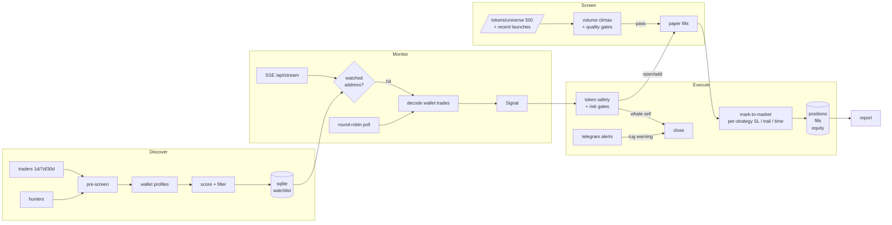

# Elysium paper desk

Two paper strategies on [Elysium](https://elysium.eco) — Kinetiq's HYPE-gas L2
(chain id `99901`):

1. **Flow monitor** — whale discovery, live swap detection and a ranked watchlist.
   It records what proven wallets do; copy fills are **off by default**.
2. **Volume-climax screener** — the active paper strategy. It scans the liquid token
   universe, enters a 5-minute volume climax with positive net buying, and manages
   the position with a tight stop and a trailing exit.

No keys, no signing, no order routing. `PAPER` is the only execution mode.

---

## Current strategy (2026-11-16)

The switch is data-driven, not cosmetic.

**The archived copy sample loses after realistic execution.** From 2026-11-09 to
2026-11-16 the old desk closed 268 positions. Cash moved from `$1,000.00` to
`$980.49`: **−$19.51** net. The dashboard used to show `+$20.85` because realised PnL
omitted `$40.36` of entry fees; that is fixed. More importantly, the old model filled
at the whale's stale print. Re-pricing the same signals at the first pool print around
detection removes the apparent edge: a 153-signal study of market and retrace entries,
with 1% round-trip friction, was negative for every exit variant. The least-bad was
retrace entry with a 60-second hold at **−$75**.

**The volume-climax screen is the only positive family in the same data.** An hourly
study over 35 Elysium tokens and 513 signals (`vol_5m` climax, positive 1h return)
produced:

| Rule (1% round-trip cost included) | n | Mean | Median | Win | PF | First/second half |
| --- | ---: | ---: | ---: | ---: | ---: | ---: |
| hold 1 h | 513 | +6.07% | +0.45% | 52.4% | 2.08 | +7.42% / +2.93% |
| stop −10% / trail 10%→30% / 2 h | 513 | +10.83% | −0.54% | 48.3% | 2.39 | +14.45% / +2.40% |

The mean is tail-driven; the win rate is near a coin flip. That is the intended
asymmetry, not a claim of a high-win-rate system. The hourly study uses API candles
and 1% friction, not live fills or market impact. It is a filter, not a promise.

Whale prints are still monitored and logged. They are **flow information**, not an
authorization to copy.

---

## Why this data plane

Everything below was probed live; no paid key is required for the paper desk.

| Source | Endpoint | What it gives |
| --- | --- | --- |
| Leaderboard | `api.elysium.eco/api/tokens/traders?win=1d\|7d\|30d\|all&sort=realized&limit=300` | ranked wallets with realised/unrealised PnL, volume, trades, tokens, wins/losses |
| Early hunters | `api.elysium.eco/api/tokens/hunters?limit=100` | wallets that buy launches early and see 2x, with smoothed hit rate |
| Wallet profile | `api.elysium.eco/api/tokens/w/<addr>?win=7d` | closed record, board totals, per-token positions with cost basis and PnL |
| Wallet trades | `api.elysium.eco/api/tokens/w/<addr>/trades?limit=200` | decoded swaps: token, side, qty, USD, price, pool, tx, block |
| Token snapshot | `api.elysium.eco/api/tokens/<token>` | price, liquidity, honeypot verdict, rug flags, top-10 concentration, launch age |
| Live blocks | `api.elysium.eco/api/stream` (SSE) | every block + every tx, **block timestamp equals wall clock** |
| Alerts channel | `t.me/s/elysiumecoalerts` | Whale / Smart money / Launch / Rug warning posts with token, wallets, tx |

Measured on 2026-11-10: ~118 ms block time, ~62 tx/s, ~4.8M txs/24h. The SSE
`head` event carries `from_a`, `to_a`, `method_name`, labels and status for each tx,
so a watched wallet's swap is visible the second its block lands.

The public API is rate-limited: sustained bursts above roughly 20 rps return HTTP 429,
and a 120-profile discovery pass tripped it hard. The client therefore owns a global
token bucket (6 req/s, burst 6), four in-flight requests, and a 429 cooldown that
honours `Retry-After`. It adapts: the rate halves on a throttle and recovers slowly.
Discovery spends ~85 requests; monitoring a 25-wallet list costs ~1.3 rps plus one
request per detected block hit.

The paid `mcp.elysium.eco` server (28 tools, 1.5M requests per HYPE for 30 days) is
**not** required; it is a drop-in upgrade for deeper per-transaction queries later.

---

## Pipeline



**Latency model.** Detection is the SSE path (block lands → wallet matched → decoded
trade fetched). The decoded feed trails the block by roughly a second; the engine
records that gap per signal in `signals.latency_ms`. Polling is the fallback when the
stream is down: it re-reads a rolling window anchored at monitor start, so indexing
lag cannot push a trade past a cursor, while a per-wallet decode cooldown bounds the
request rate. This is the honest latency of copying on this venue today; it is good
enough for a minute-scale memecoin trade, not for out-running an MEV bot.

The volume-climax screen does not wait on the decoded trade feed. It samples the top 500
tokens once per `ELYS_MOMENTUM_INTERVAL_S` (30 s), probes up to 20 recent launches, and
confirms a candidate with one fresh token request, so its execution latency is the scan
interval plus those requests.
The trade-off is coverage: a climax that opens and closes inside one interval is missed.

---

## Quickstart

```powershell
cd C:\Workspace\elysium
cp .env.example .env          # optional; defaults work
.\.venv\Scripts\python.exe -m elys init
.\.venv\Scripts\python.exe -m elys watch
```

`watch` starts the volume-climax screen. Whale discovery and monitoring start only when
a watchlist exists; run `elys discover --top 30` first if you also want the flow feed.
`watch` runs until Ctrl-C. For a bounded run: `watch --seconds 300`.

Dependencies: Python ≥ 3.11, `httpx`; `telethon` only for the optional push feed.

```powershell
python -m venv .venv
.\.venv\Scripts\python.exe -m pip install -r requirements.txt
.\.venv\Scripts\python.exe -m pytest
```

---

## Commands

| Command | Purpose |
| --- | --- |
| `elys init` | create `data/`, the sqlite ledger, seed cash |
| `elys discover [--limit N] [--top N] [--json] [--keep-stale]` | rebuild the ranked watchlist from live data |
| `elys list [--all]` | show the saved watchlist |
| `elys watch [--seconds N] [--no-stream] [--no-tg]` | run the volume-climax screen and monitor whale flow |
| `elys paper` | alias for `watch` |
| `elys serve [--host H] [--port P]` | run the desk **and** the web dashboard in one process |
| `elys replay [--minutes N] [--seconds N]` | copy-only replay: rewind the detection floor and replay recent whale trades (screen disabled; fills at the observed trade price) |
| `elys report [--json]` | win rate, expectancy, profit factor, drawdown, attribution |
| `elys status` | chain head, watcher count, screen scans/candidates, open positions, equity |
| `elys tg sync [--pages N]` | pull the public channel without any login |
| `elys tg backfill` | pull history through Telethon (needs `TG_API_ID`/`TG_API_HASH`) |
| `elys tg listen` | live push from the channel through Telethon |
| `elys reset-paper --yes` | wipe the paper ledger |

Signals print one line each:

```
21:57:04 BUY  0x9f67…91d4 HYPEPE        $5.1K @ $0.00058   lat   900ms  OPEN $33.75
02:50:45 SCAN BUY  SYMB  $25.00 @ 0.0001441  accel 11.9x buy 100% mcap $140,118
```

---

## Discovery and scoring

Candidates come from the union of the 1d/7d/30d leaderboards (300 rows each) and the
hunter board. The flow is deliberately cheap, because the API punishes bursts:

1. merge rows by wallet (max realised/volume/trades/tokens across windows);
2. drop wallets idle for more than an hour — they cannot be copied now;
3. pre-screen on trades ≥ 20, tokens ≥ 3, realised ≥ $500 and raw win rate ≥ 40 %;
4. rank those by a preliminary score and pull the recent trade tape for the top 40;
5. score again with recency and copyability, keep only wallets that pass every gate.

That is roughly 85 requests and 20–80 s depending on throttling, versus the
240-request first version that tripped the rate limiter hard.

Hard gates (all configurable):

- ≥ 20 trades and ≥ 3 distinct tokens — one lucky launch is not a strategy
- ≥ $500 realised PnL
- shrunk win rate ≥ 0.50 — `(wins + 0.5·12) / (wins + losses + 12)`; this is what stops
  a 1-win wallet from outranking a 180/120 record
- last trade within `ELYS_DISCOVER_MAX_IDLE_S` (1 hour)
- at least one recent buy ≥ `ELYS_MIN_WHALE_USD` — the wallet must be doing something
  we could actually follow, not scalping $7 clips
- no closed record → rejected

Score (0–100) is the sum of seven bounded components:

| Component | Max | Rule |
| --- | --- | --- |
| win rate | 30 | full at shrunk 0.70, zero at 0.45 |
| realised PnL | 20 | log scale, full at $100k |
| diversity | 10 | distinct tokens, full at 10 |
| activity | 10 | trades, full at 200 |
| recency | 10 | linear to zero after one hour idle |
| hunter | 10 | smoothed early-buy hit rate, full at 0.70 |
| copyability | 10 | largest recent buy, full at 4× the copy floor |

Tiers: `whale` (≥ $50k and shrunk WR ≥ 0.55), `smart` (≥ $10k), `hunter` (≥ 3 early
entries, ≥ 2 hits), else `watch`. Only wallets that pass every gate are persisted and
monitored, capped at `ELYS_MAX_WATCH` (32) by score.

A live pass over 613 leaderboard wallets produced 25 copyable wallets: 50–100 % raw win
rate, $2.9k–$28.7k realised, 4–56 recent buys, largest recent buy $295–$7.3k.

### Curated seed list

`seed/whales.json` (override with `ELYS_SEED_PATH`, empty disables) holds a durable
roster of wallets with a proven closed record that the 300-row leaderboard pages can
forget. Every seeded address is re-scored on each discovery pass from live trades and
the usual gates — idle or thin wallets are still rejected — the file only stops a
proven wallet from dropping out of the candidate set while it is quiet. Entries are
either bare address strings or wallet objects; the shipped file also carries the
evidence (`realized_usd`, `trades`, `tokens`, `currently_copyable`) and a link to the
explorer profile for each address.

## Volume-climax screen

`elys watch` starts the screen by default. Every `ELYS_MOMENTUM_INTERVAL_S` (30 s) it
fetches `GET /api/tokens/universe?sort=vol&limit=500` — one request — and evaluates the
rolling fields the explorer already computes. Recent launches from the last hour (up to
20) are also probed and must pass the same gates. A candidate must pass every gate:

| Gate | Default |
| --- | --- |
| market cap | ≥ `$100k` |
| liquidity | ≥ `$15k` |
| 1 h volume | ≥ `$1k` |
| volume climax | `vol_1h / avg(prior 5 h)` ≥ 1.5 |
| buy pressure | `buys_1h / (buys_1h + sells_1h)` ≥ 0.55 |
| net flow | `net_1h > 0` |
| 1 h return | `chg_1h` ≥ 0 % (no upper cap) |
| 5 m spike | `chg_5m` between −5 % and +15 % |
| age | ≥ 30 min |
| safety | `hp_verdict=clean`, no rug flags, top-10 ≤ 45 %, underwater ≤ 95 %, clusters ≤ 3, insider ≤ 20 % |

A token is entered at most once per hour, up to three momentum positions, and at most
two new entries per scan. The fresh token object is fetched again before the fill, so a
stale universe snapshot cannot open a position at a dead price.

Momentum exits are separate from copy exits:

| Exit | Default |
| --- | --- |
| stop loss | −10 % |
| trailing stop | arms at +10 % peak, closes on 30 % giveback |
| take profit | +150 % |
| time stop | 120 min |
| rug / honeypot | immediate |

Fills use the market price at fill time plus `ELYS_FEE_BPS` (50 bps), `ELYS_SLIPPAGE_BPS`
(50 bps) and constant-product impact, capped at `ELYS_MAX_IMPACT_BPS`.

## Copy rules and risk

Copy fills are opt-in: `ELYS_COPY_ENABLED=false` is the default. The monitor still
records whale signals and scores the watchlist. When copy fills are enabled, all of
these hold:

- the whale scores ≥ `ELYS_MIN_COPY_SCORE` (65) and its tape is copyable: at most
  5,000 trades and 300 trades per token — high-frequency scalpers are not copyable at
  retail latency;
- at least `ELYS_MIN_CONVICTION_WALLETS` (2) distinct whales bought the same token
  inside `ELYS_CONVICTION_WINDOW_S` (10 min);
- the token is `clean` (honeypot verdict `clean`, no flag, no rug, holders not wiped);
- market cap ≥ $100k, liquidity ≥ $15k, top-10 concentration ≤ 45 %, underwater
  holders ≤ 95 %, clusters ≤ 3, insider ≤ 20 % — missing safety fields veto the trade;
- the hourly tape has ≥ 5 trades, a buy ratio ≥ 0.55, `net_1h > 0` and a 5-minute
  volume acceleration ≥ 1.5×;
- token age ≥ 60 s — enough to avoid the deployer's first minute;
- the whale's own fill is ≤ `ELYS_MAX_TRADE_LIQ_PCT` (1 %) of pool liquidity — a trade
  that moved the pool is not copyable at the price it printed;
- the signal is ≤ `ELYS_MAX_SIGNAL_LATENCY_S` (180 s) old, measured on the trade
  timestamp rather than detection latency;
- the market is ≤ `ELYS_MAX_CHASE_PCT` (3 %) above the whale's fill — no chasing;
- no position in the same token closed within `ELYS_REENTRY_GUARD_S` (10 min), and no
  entry within `ELYS_STOP_COOLDOWN_S` (6 h) of a stop-out on that token;
- opening + pending exposure < `ELYS_MAX_POSITIONS`;
- the daily-loss kill switch has not tripped; it latches for the UTC day.

Sizing: `per_trade_usd × copy_weight(score)`, capped by `max_token_usd`.

### Entry modes

`ELYS_ENTRY_MODE=retrace` (default) treats the whale's fill as a trigger, not an
execution price. A passing buy arms a **resting limit** at `whale fill × (1 +
ELYS_RETRACE_LIMIT_PCT)` (2 %) with a 180 s TTL; the position opens only when the
market prints at or below that limit (`check_pending`, every marker tick). The next
whale buy on the same token **exits into the pop** (`pop_exit`), and a whale sell
closes at market as usual. The measured prior over the captured tapes: +2.1 % median
per trade (mean −8.7 %, 51 % win, n=35) unconditionally, +9.5 % median when a second
buy arrives within five minutes (n=41). It is a thin, tail-heavy edge — a prior, not a
promise.

`ELYS_ENTRY_MODE=market` is the old behaviour: open immediately at the detection price,
only when the market is within `ELYS_MAX_CHASE_PCT` (3 %) of the whale's fill. A second
whale buying the same token *adds* up to `max_adds_per_token` and the token cap. A
whale sell closes the copied position immediately (`copy_sells`). Telegram rug warnings
close it too.

Exits, checked every ~3 s:

| Exit | Default |
| --- | --- |
| stop loss | −35 % from entry |
| take profit | +150 % |
| trailing stop | arms at +60 % peak, closes on 30 % giveback |
| time stop | 240 minutes |
| rug / honeypot flag | immediate |
| whale exit / rug alert | immediate |

Paper fidelity: fills use the **market price at detection** (`ELYS_FILL_AT_MARKET`), not
the whale's stale fill price — a 90 s-old print is a trigger, not an execution price.
Each side pays `ELYS_FEE_BPS` (50 bps) plus `ELYS_SLIPPAGE_BPS` (50 bps) of execution
friction plus constant-product impact `usd / pool_liquidity`, capped at
`ELYS_MAX_IMPACT_BPS` (500 bps). So $25 into a $15k pool costs ~0.7 % per side. The
whale-trade/liquidity gate (`ELYS_MAX_TRADE_LIQ_PCT`, 1 %) rejects a signal whose own
trade moved more than 1 % of the pool; the impact cap is a modelling ceiling, not a
rejection rule. Cash and equity are tracked in sqlite, every fill is written to `fills`,
and the report only counts realised, closed trades.

The kill switch compares current equity with the first equity snapshot of the UTC day:
a 10 % drawdown stops new entries for the rest of the day, and a 30 % drawdown from
the starting balance stops everything.

---

## Dashboard

`elys serve` runs the desk and a zero-dependency dashboard (stdlib `ThreadingHTTPServer`,
server-rendered HTML, one small JSON poller). The engine writes; the web thread claims
read-only SQLite connections against the WAL database.

| Page | Content |
| --- | --- |
| `/` | equity, realised PnL, win rate, open exposure, open positions, latest signals, watchlist, screen scans |
| `/positions` | resting limits, open and closed fills with strategy, entry/mark, PnL, exit reason |
| `/signals` | every detected swap and screen candidate with decision, reason and latency |
| `/whales` | the copyable watchlist with score, win rate, trades, realised, last trade |
| `/alerts` | the public channel's posts, linked back to the explorer |

`/healthz` reports only liveness (status, heartbeat age, stream, whale count); account
figures stay behind `/api/summary`. `/api/summary` feeds the live status strip and now
includes `momentum_open`, `scan_scans` and `scan_candidates`. When `ELYS_WEB_PASSWORD`
is set the dashboard requires HTTP Basic auth (user `ELYS_WEB_USER`, default `elys`).
The watchlist re-runs discovery every `ELYS_REBALANCE_HOURS` (default 6).

Design rules: tables and one figure strip, tabular numbers, one accent, semantic colour
always paired with a label, no gradients, no icon-only actions, no card per scalar.

---

## Deployment

Live at `https://elysium.warga-digital.com` on a private VPS, behind OpenLiteSpeed with a
Cloudflare-proxied A record. The dashboard is public; set `ELYS_WEB_PASSWORD` in the host
`.env` to require HTTP Basic auth (user `ELYS_WEB_USER`, default `elys`).

| Piece | Location |
| --- | --- |
| App + venv | `$APP_DIR` (e.g. `/opt/elysium`) |
| Service | `systemd elysium-desk.service` → `127.0.0.1:18086` |
| Proxy | OpenLiteSpeed vhost `deploy/vhost.conf` (`respBuffer 0`) |
| DNS | proxied Cloudflare A record → the host's public IP |

```bash
# on the host, from the repo checkout (adjust user/paths in the unit first)
python3.12 -m venv .venv && .venv/bin/pip install -r requirements.txt
.venv/bin/python -m elys init
.venv/bin/python -m elys discover --top 32
sudo cp deploy/elysium-desk.service /etc/systemd/system/
sudo systemctl daemon-reload && sudo systemctl enable --now elysium-desk
sudo /usr/local/lsws/bin/lswsctrl reload
```

### v2 cutover (2026-11-16)

The old ledger stays on disk as evidence. Start the new strategy in its own database
instead of resetting it:

```bash
# /home/valarion/apps/elysium/.env
ELYS_DB=data/elys-v2.db
ELYS_COPY_ENABLED=false
ELYS_MOMENTUM=true
```

Then `sudo systemctl restart elysium-desk` and confirm `/api/summary` reports
`momentum_open`, `scan_scans` growing, and `stream` state. The old `data/elys.db`
remains the archived copy experiment.

---

## Layout

```
elys/
  config.py      .env → typed settings
  util.py        address normalisation, formatting
  intel.py       explorer API client (cached, concurrent, retrying)
  scoring.py     pure wallet scoring and filters
  discovery.py   leaderboard + hunters + seed file → ranked watchlist
  seeds.py       curated wallet seed list (validated addresses)
  stream.py      SSE block stream
  monitor.py     SSE fast path + polling fallback → Signal
  strategy.py    copy-flow gates, sizing, entry/add/exit decisions
  momentum.py    volume-climax screen, candidate ranking and paper entries
  paper.py       fills, mark-to-market, per-strategy exits, equity, kill switch
  tgfeed.py      telegram web feed + optional Telethon push
  store.py       sqlite schema and ledger
  report.py      performance summary and strategy attribution
  cli.py         command line
  web.py         dashboard (stdlib HTTP, read-only SQLite)
tests/           98 tests covering scoring, parsing, detection, fills, exits, gates,
                 atomic ledger transitions, the screener and the dashboard
```

State lives in `data/elys.db` (WAL). Logs in `data/elys.log`. `data/` is gitignored.

---

## Verification

- `pytest`: 98 passed — scoring maths, shrinkage and recent-activity gates, Telegram
  HTML parsing, fill accounting and average entry, stop-loss / take-profit / trailing /
  rug exits, fee-inclusive realised PnL, exactly-once close, latched daily halt,
  atomic open/add/close, signal dedupe, monitor decoding, pending-order claim/TTL,
  copy-flow and screener gates, and the dashboard.
- Fee reconciliation: a flat $100 round trip at 50 bps per side now reports **−$1.00**
  realised and moves cash by exactly −$1.00; the old report said −$0.50.
- Concurrent-close reproduction: a second close of the same position returns
  `position already closed`, appends no fill and leaves cash unchanged.
- Live screener smoke (2026-11-16): `GET /api/tokens/universe?limit=200` → candidate →
  `SCAN BUY SYMB $25.00 @ 0.00014413503 accel 11.9x buy 100% mcap $140,118`; the
  position was persisted with `strategy='momentum'`, cash `$974.88`, equity `$999.73`.
- Screen-only CLI run: `elys watch --seconds 25 --no-tg --no-stream` with no active
  whales started the scanner, ran five scans and exited cleanly.
- Hourly strategy study (35 tokens, 513 signals, 1 % round-trip cost): hold 1 h mean
  +6.07 %, median +0.45 %, win 52.4 %, PF 2.08; stop −10 % / trail 10→30 % / 2 h mean
  +10.83 %, PF 2.39 — both chronological halves positive.
- Copy entry study (153 signals with decoded pool paths): market and retrace entries
  were negative under realistic fills; the best variant (retrace + 60 s hold) lost
  $75. This is why copy fills are off by default.
- Live discovery against `api.elysium.eco`: 613 leaderboard wallets → 155 candidates →
  80 trade-tape probes → 25 copyable wallets in ~78 s under throttling.
- Live stream matching: 65 wallets taken from a hot token's trade tape produced 67
  block hits in 25 s, each a `permit2TransferAndMulticall` transaction.
- `elys replay --minutes 25 --seconds 120` (copy-only replay) produced 11 signals, 5
  paper fills ($22.50–$33.00 each), 4 tokens vetoed on liquidity and 1 on the token cap,
  one whale-exit close (+$1.61) and one stop-loss close (−$22.11). Replay disables the
  screen and is a pipeline check, not a PnL forecast.

---

## Limits and the path to live

- **Copy edge is negative after realistic fills.** The archived sample and the
  153-signal entry study both lose once entries are priced at the market reachable at
  detection. The old positive display came from stale-price fills and entry fees omitted
  from realised PnL; both are fixed. Copy fills stay opt-in.
- **Screen latency is one interval.** The universe scan runs every 30 s and a candidate
  is confirmed with a fresh token object before the paper fill. A climax that starts and
  ends inside one interval can be missed; a faster cadence costs API budget and risks
  429s. The screen is a minute-scale strategy, not an MEV strategy.
- **Screen evidence is hourly, not live.** The +6 %/+10 % study used API candles and a
  1 % round-trip cost, not queue position, impact or failed transactions. The forward
  paper ledger — not the study — is the judge.
- **Price impact** is modelled as `usd / pool_liquidity`, capped at 500 bps. The
  constant-product approximation is reasonable for $25 into a $15k+ pool; it is not a
  router simulation.
- **Execution** is paper only. Going live needs a signer, gas management, allowance
  handling, nonce discipline and a router adapter per launchpad (Montra, Ascend, …).
- **Data** has no SLA. The universe endpoint is one request per 30 s; confirmation and
  marks add a few more. The client retries with backoff, but a paid intel key is the
  upgrade path.
- The explorer's win/loss record is per position; a wallet that scalps thousands of
  tiny winners can look perfect. Wallet scoring is flow research, not a profitability
  guarantee.

A quiet market legitimately shows zero screen candidates for minutes or hours. The
screen trades a few times a day, not continuously. Use `status` to see scan counts,
`report` for strategy attribution, and let a long-running `watch` build the forward
record.

Nothing here is financial advice, and paper results are not live results.
