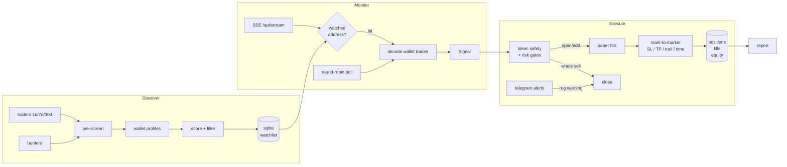

# Elysium copy-trading desk (paper)

Whale discovery, real-time monitoring and paper-executed copy trading on
[Elysium](https://elysium.eco) — Kinetiq's HYPE-gas L2 (chain id `99901`).

The desk answers three questions continuously:

1. **Who is actually winning?** — wallets ranked on realised PnL, sample-size-shrunk
   win rate, token diversity, recency and launch-hunting record.
2. **What are they doing right now?** — sub-second detection of their swaps from the
   chain's live block stream, decoded to token/side/size/price.
3. **What would copying them have made?** — a paper account that fills at the observed
   price with modelled slippage and fees, then manages real exits.

No keys, no signing, no order routing. `PAPER` is the only execution mode.

---

## Why this data plane

Everything below was probed live; no paid key is required for the paper desk.

| Source | Endpoint | What it gives |
| --- | --- | --- |
| Leaderboard | `api.elysium.eco/api/tokens/traders?win=1d\|7d\|30d\|all&sort=realized&limit=300` | ranked wallets with realised/unrealised PnL, volume, trades, tokens, wins/losses |
| Early hunters | `api.elysium.eco/api/tokens/hunters?limit=100` | wallets that buy launches early and see 2x, with smoothed hit rate |
| Wallet profile | `api.elysium.eco/api/tokens/w/<addr>?win=7d` | closed record, board totals, per-token positions with cost basis and PnL |
| Wallet trades | `api.elysium.eco/api/tokens/w/<addr>/trades?limit=200` | decoded swaps: token, side, qty, USD, price, pool, tx, block |
| Token snapshot | `api.elysium.eco/api/tokens/<token>` | price, liquidity, honeypot verdict, rug flags, top-10 concentration, launch age |
| Live blocks | `api.elysium.eco/api/stream` (SSE) | every block + every tx, **block timestamp equals wall clock** |
| Alerts channel | `t.me/s/elysiumecoalerts` | Whale / Smart money / Launch / Rug warning posts with token, wallets, tx |

Measured on 2026-11-10: ~118 ms block time, ~62 tx/s, ~4.8M txs/24h. The SSE
`head` event carries `from_a`, `to_a`, `method_name`, labels and status for each tx,
so a watched wallet's swap is visible the second its block lands.

The public API is rate-limited: sustained bursts above roughly 20 rps return HTTP 429,
and a 120-profile discovery pass tripped it hard. The client therefore owns a global
token bucket (6 req/s, burst 6), four in-flight requests, and a 429 cooldown that
honours `Retry-After`. It adapts: the rate halves on a throttle and recovers slowly.
Discovery spends ~85 requests; monitoring a 25-wallet list costs ~1.3 rps plus one
request per detected block hit.

The paid `mcp.elysium.eco` server (28 tools, 1.5M requests per HYPE for 30 days) is
**not** required; it is a drop-in upgrade for deeper per-transaction queries later.

---

## Pipeline



**Latency model.** Detection is the SSE path (block lands → wallet matched → decoded
trade fetched). The decoded feed trails the block by roughly a second; the engine
records that gap per signal in `signals.latency_ms`. Polling is the fallback when the
stream is down: it re-reads a rolling window anchored at monitor start, so indexing
lag cannot push a trade past a cursor, while a per-wallet decode cooldown bounds the
request rate. This is the honest latency of copying on this venue today; it is good
enough for a minute-scale memecoin trade, not for out-running an MEV bot.

---

## Quickstart

```powershell
cd C:\Workspace\elysium
cp .env.example .env          # optional; defaults work
.\.venv\Scripts\python.exe -m elys init
.\.venv\Scripts\python.exe -m elys discover --top 30
.\.venv\Scripts\python.exe -m elys watch
```

`watch` runs until Ctrl-C. For a bounded run: `watch --seconds 300`.

Dependencies: Python ≥ 3.11, `httpx`; `telethon` only for the optional push feed.

```powershell
python -m venv .venv
.\.venv\Scripts\python.exe -m pip install -r requirements.txt
.\.venv\Scripts\python.exe -m pytest
```

---

## Commands

| Command | Purpose |
| --- | --- |
| `elys init` | create `data/`, the sqlite ledger, seed cash |
| `elys discover [--limit N] [--top N] [--json] [--keep-stale]` | rebuild the ranked watchlist from live data |
| `elys list [--all]` | show the saved watchlist |
| `elys watch [--seconds N] [--no-stream] [--no-tg]` | monitor + copy trade on paper |
| `elys paper` | alias for `watch` |
| `elys serve [--host H] [--port P]` | run the desk **and** the web dashboard in one process |
| `elys replay [--minutes N] [--seconds N]` | rewind the detection floor and replay recent whale trades through the engine (backtest-style; fills at the observed trade price, staleness kept in `latency_ms`) |
| `elys report [--json]` | win rate, expectancy, profit factor, drawdown, attribution |
| `elys status` | chain head, watcher count, open positions, equity |
| `elys tg sync [--pages N]` | pull the public channel without any login |
| `elys tg backfill` | pull history through Telethon (needs `TG_API_ID`/`TG_API_HASH`) |
| `elys tg listen` | live push from the channel through Telethon |
| `elys reset-paper --yes` | wipe the paper ledger |

Signals print one line each:

```
21:57:04 BUY  0x9f67…91d4 HYPEPE        $5.1K @ $0.00058   lat   900ms  OPEN $33.75
```

---

## Discovery and scoring

Candidates come from the union of the 1d/7d/30d leaderboards (300 rows each) and the
hunter board. The flow is deliberately cheap, because the API punishes bursts:

1. merge rows by wallet (max realised/volume/trades/tokens across windows);
2. drop wallets idle for more than an hour — they cannot be copied now;
3. pre-screen on trades ≥ 20, tokens ≥ 3, realised ≥ $500 and raw win rate ≥ 40 %;
4. rank those by a preliminary score and pull the recent trade tape for the top 40;
5. score again with recency and copyability, keep only wallets that pass every gate.

That is roughly 85 requests and 20–80 s depending on throttling, versus the
240-request first version that tripped the rate limiter hard.

Hard gates (all configurable):

- ≥ 20 trades and ≥ 3 distinct tokens — one lucky launch is not a strategy
- ≥ $500 realised PnL
- shrunk win rate ≥ 0.50 — `(wins + 0.5·12) / (wins + losses + 12)`; this is what stops
  a 1-win wallet from outranking a 180/120 record
- last trade within `ELYS_DISCOVER_MAX_IDLE_S` (1 hour)
- at least one recent buy ≥ `ELYS_MIN_WHALE_USD` — the wallet must be doing something
  we could actually follow, not scalping $7 clips
- no closed record → rejected

Score (0–100) is the sum of seven bounded components:

| Component | Max | Rule |
| --- | --- | --- |
| win rate | 30 | full at shrunk 0.70, zero at 0.45 |
| realised PnL | 20 | log scale, full at $100k |
| diversity | 10 | distinct tokens, full at 10 |
| activity | 10 | trades, full at 200 |
| recency | 10 | linear to zero after one hour idle |
| hunter | 10 | smoothed early-buy hit rate, full at 0.70 |
| copyability | 10 | largest recent buy, full at 4× the copy floor |

Tiers: `whale` (≥ $50k and shrunk WR ≥ 0.55), `smart` (≥ $10k), `hunter` (≥ 3 early
entries, ≥ 2 hits), else `watch`. Only wallets that pass every gate are persisted and
monitored, capped at `ELYS_MAX_WATCH` (32) by score.

A live pass over 613 leaderboard wallets produced 25 copyable wallets: 50–100 % raw win
rate, $2.9k–$28.7k realised, 4–56 recent buys, largest recent buy $295–$7.3k.

## Copy rules and risk

A signal is copied only when all of these hold:

- the whale scores ≥ 40;
- the token is `clean` (no honeypot verdict/flag, no rug, holders not wiped);
- liquidity ≥ $15k, top-10 concentration ≤ 45%;
- token age ≥ 60 s — enough to avoid the deployer's first minute;
- position count < `ELYS_MAX_POSITIONS`;
- the daily-loss kill switch has not tripped.

Sizing: `per_trade_usd × copy_weight(score)`, capped by `max_token_usd`. A second
whale buying the same token *adds* to the position up to `max_adds_per_token` and the
token cap — that is conviction, not a new position. A whale sell closes the copied
position immediately (`copy_sells`). Telegram rug warnings close it too.

Exits, checked every ~3 s:

| Exit | Default |
| --- | --- |
| stop loss | −35 % from entry |
| take profit | +150 % |
| trailing stop | arms at +60 % peak, closes on 30 % giveback |
| time stop | 240 minutes |
| rug / honeypot flag | immediate |
| whale exit / rug alert | immediate |

Paper fidelity: entry and exit each pay `ELYS_SLIPPAGE_BPS` (150 bps) and
`ELYS_FEE_BPS` (50 bps), cash and equity are tracked in sqlite, and every fill is
written to `fills`. The report only counts realised, closed trades.

The kill switch compares current equity with the first equity snapshot of the UTC day:
a 10 % drawdown stops new entries for the rest of the day, and a 30 % drawdown from
the starting balance stops everything.

---

## Dashboard

`elys serve` runs the desk and a zero-dependency dashboard (stdlib `ThreadingHTTPServer`,
server-rendered HTML, one small JSON poller). The engine writes; the web thread claims
read-only SQLite connections against the WAL database.

| Page | Content |
| --- | --- |
| `/` | equity, realised PnL, win rate, open exposure, open positions, latest signals, watchlist |
| `/positions` | open and closed fills with entry/mark, PnL, exit reason |
| `/signals` | every detected swap with decision, reason and detection latency |
| `/whales` | the copyable watchlist with score, win rate, trades, realised, last trade |
| `/alerts` | the public channel's posts, linked back to the explorer |

`/healthz` reports worker heartbeat and stream state; `/api/summary` feeds the live
status strip. When `ELYS_WEB_PASSWORD` is set the dashboard requires HTTP Basic auth
(user `ELYS_WEB_USER`, default `elys`). The watchlist re-runs discovery every
`ELYS_REBALANCE_HOURS` (default 6).

Design rules: tables and one figure strip, tabular numbers, one accent, semantic colour
always paired with a label, no gradients, no icon-only actions, no card per scalar.

---

## Deployment

Live at `https://elysium.warga-digital.com` on a private VPS, behind OpenLiteSpeed with a
Cloudflare-proxied A record. The dashboard is public; set `ELYS_WEB_PASSWORD` in the host
`.env` to require HTTP Basic auth (user `ELYS_WEB_USER`, default `elys`).

| Piece | Location |
| --- | --- |
| App + venv | `$APP_DIR` (e.g. `/opt/elysium`) |
| Service | `systemd elysium-desk.service` → `127.0.0.1:18086` |
| Proxy | OpenLiteSpeed vhost `deploy/vhost.conf` (`respBuffer 0`) |
| DNS | proxied Cloudflare A record → the host's public IP |

```bash
# on the host, from the repo checkout (adjust user/paths in the unit first)
python3.12 -m venv .venv && .venv/bin/pip install -r requirements.txt
.venv/bin/python -m elys init
.venv/bin/python -m elys discover --top 32
sudo cp deploy/elysium-desk.service /etc/systemd/system/
sudo systemctl daemon-reload && sudo systemctl enable --now elysium-desk
sudo /usr/local/lsws/bin/lswsctrl reload
```

---

## Layout

```
elys/
  config.py      .env → typed settings
  util.py        address normalisation, formatting
  intel.py       explorer API client (cached, concurrent, retrying)
  scoring.py     pure wallet scoring and filters
  discovery.py   leaderboard + hunters → ranked watchlist
  stream.py      SSE block stream
  monitor.py     SSE fast path + polling fallback → Signal
  strategy.py    token/risk gates, sizing, entry/add/exit decisions
  paper.py       fills, mark-to-market, exits, equity, kill switch
  tgfeed.py      telegram web feed + optional Telethon push
  store.py       sqlite schema and ledger
  report.py      performance summary
  cli.py         command line
  web.py         dashboard (stdlib HTTP, read-only SQLite)
tests/           55 tests covering scoring, parsing, detection, fills, exits, gates and dashboard
```

State lives in `data/elys.db` (WAL). Logs in `data/elys.log`. `data/` is gitignored.

---

## Verification

- `pytest`: 52 passed — scoring maths, shrinkage and recent-activity gates, Telegram
  HTML parsing, fill accounting and average entry, stop-loss / take-profit / trailing /
  rug exits, daily-loss halt, signal dedupe, monitor decoding (dedupe, size floor,
  sell-only-on-open-position, hash-restricted stream matching), and strategy gates
  (honeypot, liquidity, age, low score, max positions, add caps, whale-sell and
  rug-alert closes).
- Live discovery against `api.elysium.eco`: 613 leaderboard wallets → 155 candidates →
  80 trade-tape probes → 25 copyable wallets in ~78 s under throttling.
- Live stream matching: 65 wallets taken from a hot token's trade tape produced 67
  block hits in 25 s, each a `permit2TransferAndMulticall` transaction — the fast path
  is real, not theoretical.
- Live watch runs: the desk streamed 200–1 200 blocks per 30 s with the stream up and
  single-digit 429s. A 5-minute run saw 8 block hits from watched wallets but no
  qualifying buy, because the watchlist averages well under one copyable buy per
  wallet-hour — market cadence, not a broken pipeline.
- `elys replay --minutes 25 --seconds 120` on live data produced 11 signals, 5 paper
  fills ($22.50–$33.00 each), 4 tokens vetoed on liquidity and 1 on the token cap, one
  whale-exit close (+$1.61) and one stop-loss close (−$22.11). The replay ledger was
  reset afterwards; run it yourself to re-check the pipeline end to end.

---

## Limits and the path to live

- **Detection** trails the block by ~1 s because the decoded trade feed is indexed
  after the block. Raw SSE tells you a transaction exists, not that it is a buy.
  Removing that second means decoding Swap logs yourself from the RPC
  (`rpc.elysium.kinetiq.xyz`) and maintaining the router/pool ABI mapping.
- **Price** is the whale's realised pool price. A real copy lands later and moves the
  pool; the 150 bps slippage model is a blunt approximation of that impact. `replay`
  fills at that same observed price, so it is a pipeline check, not a PnL forecast.
- **Execution** is paper only. Going live needs a signer, gas management, allowance
  handling, nonce discipline and a router adapter per launchpad (Montra, Ascend, …).
- **Data** has no SLA. The public API can rate-limit; the client retries with backoff
  and the poll loop survives stream failure, but a paid intel key is the upgrade path.
- The explorer's win/loss record is per position; a wallet that scalps thousands of
  tiny winners can look perfect. The diversification, activity and PnL components are
  there to keep such wallets from dominating the list, but the paper report — not the
  leaderboard — is the source of truth for whether copying them works.

Short watch windows can legitimately show zero signals: 25 wallets that buy a few
times a day produce under one copyable buy per five minutes. That is why `replay` and
`report` exist — use replay to exercise the desk, and let a long-running `watch` build
the realised record.

Nothing here is financial advice, and paper results are not live results.
